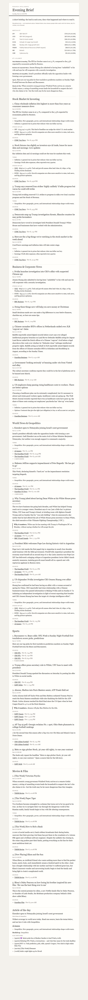

# Research Intelligence Engine

A daily research brief I run for myself. It pulls public RSS, clusters and ranks stories in my own code, writes the brief locally, and emails it to me. Domains are markets, business, world news, sports, and movies.

Public RSS only: the headline, the publisher’s short blurb, and a link. The brief uses original wording and links back to the source. Checks for the known failure cases live in `tests/test_brief_quality.py`.

One real evening run: [docs/sample-brief.md](docs/sample-brief.md). The email version of that same brief is below, and the HTML is [docs/evening-brief.html](docs/evening-brief.html).



## Pipeline

1. **Ingest** — pull free public RSS (and TMDB for movies) into SQLite
2. **Cluster** — group headlines that are the same story
3. **Rank** — keep the top 5 topics per domain
4. **Write** — build each card from the feed lead
5. **Email** — send the morning or evening brief
6. **Prune** — drop old articles and brief files so storage stays small

A card uses the headline it claims. Enrichment is kept only when it is the same story. Stock lines appear only when the headline is about rates, oil, AI, cyber, or biotech. Betting-app promos are dropped. The same story is not repeated in two sections.

## Free and legal

- Public RSS only (no paywall scraping)
- Store headline + short feed blurb + link
- Original brief wording + source links
- Local template writer (optional Ollama later)

See [FREE_AND_LEGAL.md](FREE_AND_LEGAL.md).

## Setup

```powershell
cd research-intelligence-engine
python -m venv .venv
.\.venv\Scripts\pip.exe install -e .
copy .env.example .env
```

Edit `.env` and set `EMAIL_APP_PASSWORD` to your Gmail App Password.

If PowerShell blocks Activate.ps1, call Python directly:

```powershell
.\.venv\Scripts\python.exe -m research_intel.jobs.run_daily evening
```

## One-command daily run

```powershell
.\.venv\Scripts\python.exe -m research_intel.jobs.run_daily morning
.\.venv\Scripts\python.exe -m research_intel.jobs.run_daily evening
```

This pulls news, picks topics, writes the brief, emails it, and prunes old data.

Skip email for a test:

```powershell
.\.venv\Scripts\python.exe -m research_intel.jobs.run_daily evening --no-email
```

## Schedule (Windows)

Morning **6:30 AM** every day. If the PC is asleep then, that run is skipped. It does not send later in the day. A start at or after **9:00 AM** local is also skipped.

```powershell
powershell -ExecutionPolicy Bypass -File .\scripts\install_schedule.ps1
```

Your PC needs to be on (or awake) at 6:30 while you're logged in. Logs go to `data\logs\scheduler.log`.

To write a morning brief after 9:00 AM on purpose:

```powershell
.\.venv\Scripts\python.exe -m research_intel.jobs.run_daily morning --allow-late
```

## Email

Configured for my email via Gmail SMTP.  
Put the App Password in `.env` as `EMAIL_APP_PASSWORD=...` (never commit `.env`).

## Storage cleanup

Defaults in `.env`:

- Articles kept **21** days  
- Briefs in DB kept **90** days  
- Only the newest **4** `.md` / `.json` brief files kept  

## Manual step-by-step commands

```powershell
.\.venv\Scripts\python.exe -m research_intel.jobs.ingest_news
.\.venv\Scripts\python.exe -m research_intel.jobs.pick_topics
.\.venv\Scripts\python.exe -m research_intel.jobs.write_brief evening
.\.venv\Scripts\python.exe -m research_intel.jobs.show_stats
```

## Project layout

- `src/research_intel/db/` — database
- `src/research_intel/ingest/` — RSS pull
- `src/research_intel/process/` — topic pick + cleanup
- `src/research_intel/generate/` — brief writer
- `src/research_intel/deliver/` — email
- `scripts/` — Task Scheduler helpers
- `data/` — database, briefs, logs (local only)
