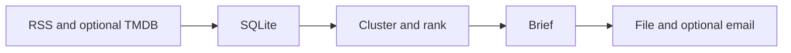

# Automated News Monitoring and Reporting

A local pipeline that turns public RSS into a daily research brief for markets, business, world news, sports, and film. It clusters headlines into events, ranks those events with an explicit formula, and writes a short brief with source links.

The default path does not call a language model and does not need a paid API. Quality rules are ordinary Python, covered by unit tests.

One rendered sample: [docs/sample-brief.md](docs/sample-brief.md). The HTML email for that sample is [docs/evening-brief.html](docs/evening-brief.html).


## Business problem

Reading five beats means opening many feeds, skipping the same story, and still missing which item is the lead. A chronological RSS list does not do that. This project produces one scanned brief: what happened, why the source says it matters, and where to read it.

## What the system does

1. Pulls public RSS into SQLite (title, the publisher's short blurb, link, time).
2. Drops betting promotions, soccer items outside the personal sports scope, and non-film items on the BBC culture feed.
3. Groups headlines that are the same event, and keeps parallel headlines apart.
4. Ranks stories by independent publishers, recency, and whether a real blurb exists. Extra copies from one feed do not raise the score.
5. Writes each card from one matching blurb. Other outlets stay as links.
6. Adds a ticker only when the headline is about that market, sector, or company, and labels it as context rather than a forecast.
7. Renders Markdown and HTML, optionally emails both, then deletes old rows and files.

Optional free keys (TMDB, Guardian, NYT, NewsAPI) add film listings or a longer blurb. With the keys empty, the brief still runs.

## Architecture



The full path, including why this is a processing system rather than an RSS reader, is in [docs/architecture.md](docs/architecture.md).

## Technology stack

- Python 3.11 or newer
- SQLite through the standard library
- `feedparser`, `httpx`, `python-dotenv`
- Standard-library SMTP
- Windows Task Scheduler for the morning run

No LangChain, no paid model API, and no hosted database.

## Clustering and ranking

Two headlines join when they share a named subject and a second detail. "Fed holds rates" and "ECB holds rates" do not join. "Apple earnings" and "Apple opens a store" do not join. Two publishers describing the same investigation do join.

The score is `4 x independent publishers + recency (0 to 5 over 36 hours) + a small blurb-quality bonus + a sports or film bonus`. The article count is not in the formula. The write-up is [docs/RANKING_METHODOLOGY.md](docs/RANKING_METHODOLOGY.md).

## Quality assurance

`python -m unittest discover -s tests` checks the rules, not just the helpers:

- A card paragraph comes from the headline's own blurb, not a neighboring story.
- Enrichment that shares a person but not the story is dropped.
- The same event is not selected in two sections. Similar headlines about different events both stay.
- Betting promotions are dropped. Injury reports, polls, and signings stay.
- China inflation and an executive-misconduct story do not receive a market fund. A Fed rates headline can show SPY as context.
- Empty feeds, malformed items, missing links, repeated sentences, and retention across timestamp formats are covered.

The audit of what was wrong, and what was changed, is [docs/PROJECT_AUDIT.md](docs/PROJECT_AUDIT.md).

## Sample output

[docs/sample-brief.md](docs/sample-brief.md) is produced by `scripts/render_sample_brief.py` from representative feed leads. It is not a live fetch. Watchlist prices in that file are a saved tape from November 8, 2026.

A real run writes `data/briefs/<morning|evening>_<timestamp>.md` and a matching JSON file. Those files are gitignored.

## Setup (Windows)

Requires Python 3.11+. From the repository root:

```powershell
py -3.11 -m venv .venv
.\.venv\Scripts\python.exe -m pip install -e .
copy .env.example .env
```

If `py` is not available, use `python` instead. Edit `.env` only if you want email. `EMAIL_APP_PASSWORD` is a Gmail app password. Leave it blank to write the brief to disk and skip the send.

`.env` is gitignored. `.env.example` lists every setting and contains no secrets.

Run the tests:

```powershell
$env:PYTHONPATH = "src"
.\.venv\Scripts\python.exe -m unittest discover -s tests -v
```

`scripts/run_scheduled.bat` sets `PYTHONPATH=src` the same way, so the scheduled job uses this checkout.

## Run it

```powershell
$env:PYTHONPATH = "src"
.\.venv\Scripts\python.exe -m research_intel.jobs.run_daily evening --no-email
.\.venv\Scripts\python.exe -m research_intel.jobs.run_daily morning
```

That pulls news, picks topics, writes the brief, emails it when `.env` is complete, and prunes old data.

Step by step:

```powershell
.\.venv\Scripts\python.exe -m research_intel.jobs.ingest_news
.\.venv\Scripts\python.exe -m research_intel.jobs.pick_topics
.\.venv\Scripts\python.exe -m research_intel.jobs.write_brief evening
.\.venv\Scripts\python.exe -m research_intel.jobs.show_stats
```

## Scheduling

Morning only, 6:30 AM local, for the Windows user who installs the task:

```powershell
powershell -ExecutionPolicy Bypass -File .\scripts\install_schedule.ps1
```

The PC has to be on and that user logged in. If the machine is asleep at 6:30, the run is not made up later. A start at or after 9:00 AM local is also skipped. To write a morning brief after that cutoff on purpose:

```powershell
.\.venv\Scripts\python.exe -m research_intel.jobs.run_daily morning --allow-late
```

Logs go to `data\logs\scheduler.log`. Evening briefs are manual.

## Storage

Defaults in `.env`:

- Articles kept 21 days
- Brief rows kept 90 days
- The newest 4 `.md` files and 4 `.json` files kept

`data/` is gitignored, including the database and generated briefs.

## Layout

- `src/research_intel/ingest/` — RSS and optional TMDB
- `src/research_intel/process/` — clustering, ranking, cleanup
- `src/research_intel/generate/` — cards and Markdown
- `src/research_intel/markets/` — watchlist and ticker context
- `src/research_intel/deliver/` — HTML email
- `src/research_intel/jobs/` — commands
- `tests/` — rule tests
- `docs/` — audit, architecture, ranking, sample
- `scripts/` — Task Scheduler and the sample renderer

## Limitations

- Clustering is lexical. A paraphrase with no shared names can be missed. A running story that keeps the same names can still be joined.
- "Why it matters" is empty when the blurb never says what happens next. The writer does not fill that gap.
- Soccer keywords are broad (`World Cup` is treated as soccer). That matches the personal sports list and can drop a non-soccer World Cup item.
- Quotes come from a public Yahoo chart endpoint used for personal context. It can fail or change. A failure leaves the price blank. It is not a forecast and not a recommendation.
- The morning job is a logged-in Task Scheduler task, not a service. It does not run when the PC is off.
- Optional news APIs and TMDB are best-effort. The RSS path does not depend on them.
- This is a personal research tool. It is not a production newsroom system. See [FREE_AND_LEGAL.md](FREE_AND_LEGAL.md).

## Further reading

- [docs/PROJECT_OVERVIEW.md](docs/PROJECT_OVERVIEW.md) — short version for a recruiter or an interview
- [docs/AI_ENABLEMENT_RELEVANCE.md](docs/AI_ENABLEMENT_RELEVANCE.md) — what the workflow demonstrates, without pretending there is a model in the loop
- [docs/PROJECT_AUDIT.md](docs/PROJECT_AUDIT.md) — what was reviewed and what changed
