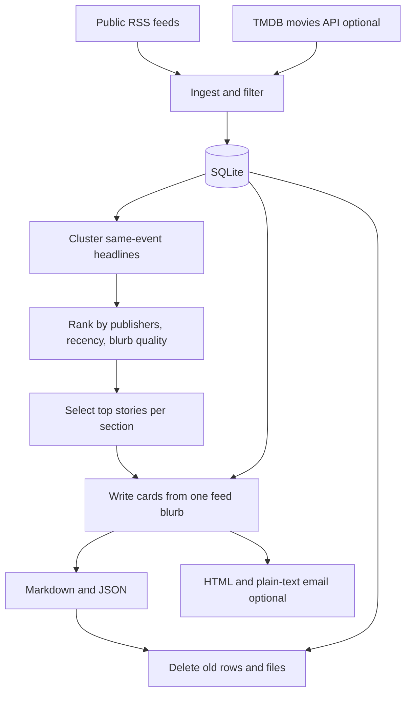

# Architecture

The Research Intelligence Engine is a local batch pipeline. One command pulls public feeds, turns headlines into stories, ranks those stories, and writes a brief. SQLite is the only database. Nothing in the default path calls a language model.

## How a brief is produced

`jobs/run_daily.py` runs that sequence for a morning or evening brief.

## What each stage does

**Ingest.** `ingest/feeds.py` downloads the feeds in `config.py` with `httpx` and parses them with `feedparser`. Each item stores the title, the publisher's short blurb, the link, and a timestamp. The URL is unique. Sports items are dropped when they are soccer coverage, a betting promotion, or non-Mets baseball on the MLB feed. BBC culture items are kept only when they are about film. Optional TMDB rows, in `ingest/tmdb.py`, add this-week and now-playing English-language titles with a release line and a short plot sentence.

**Store.** `db/schema.sql` holds sources, articles, topics, briefs, and topic cards. A few older tables (`entities`, `related`, `user_feedback`) are unused and are left in place so an existing database file still opens.

**Cluster.** `process/cluster.py` groups headlines that describe the same event. The test is lexical: shared names plus a second overlapping detail. "Fed holds rates" and "ECB holds rates" stay apart. Two publishers writing the Nvidia investigation in different words join. See `process/text.py` (`same_story`).

**Rank.** `process/rank.py` scores each cluster. Independent publishers matter. Extra copies from the same feed do not. Freshness fades over 36 hours. A real blurb adds a small bonus. Sports and movies add a subject bonus or are dropped. The top five in each domain are selected, with a pass that spreads sports and movies across buckets. A later pass removes a story that was selected twice. The formula is written out in [RANKING_METHODOLOGY.md](RANKING_METHODOLOGY.md).

**Write.** `generate/brief.py` loads the selected topics. The paragraph for a card comes from one matching feed blurb (`generate/analyze.py`). Other outlets stay in the link list. Optional Guardian, NYT, or NewsAPI text is appended only when each sentence supports the headline, and only if that key is set. Tickers are attached only when the headline is about that market, sector, or company (`markets/impact.py`). The line is labeled as context, not a forecast.

**Deliver.** `generate/render.py` and `deliver/html_email.py` render the same sections: executive overview, what happened, why it matters when the blurb supports it, and where to read more. `deliver/email.py` sends both versions through SMTP when `.env` has a recipient and an app password.

**Retain.** `process/cleanup.py` deletes articles older than 21 days and brief rows older than 90 days, and keeps the newest four Markdown and JSON files. ISO timestamps and SQLite's `YYYY-MM-DD HH:MM:SS` values are compared on the same 19-character stamp.

## Why this is not an RSS reader

An RSS reader shows a chronological list from each feed. This system does four extra jobs:

1. It decides which headlines are the same event, including across sections.
2. It ranks events with an explicit rule instead of feed order.
3. It refuses items that fail a quality rule: betting copy, a ticker that the headline does not support, a sentence that belongs to a different story.
4. It delivers one scanned brief on a schedule, then deletes old rows.

The judgment is written in Python. It is inspectable, and the tests lock the rules that used to fail. It is not a model call, and the brief does not add facts the feed blurb did not state.

## Where the code lives

| Path | Role |
|---|---|
| `src/research_intel/config.py` | Feeds, domains, retention, email settings |
| `src/research_intel/ingest/` | RSS and optional TMDB |
| `src/research_intel/process/` | Clustering, ranking, sports and film rules, cleanup |
| `src/research_intel/generate/` | Cards, glossary, Markdown |
| `src/research_intel/markets/` | Watchlist quotes and ticker context |
| `src/research_intel/deliver/` | HTML email and SMTP |
| `src/research_intel/jobs/` | Command-line entry points |
| `tests/` | Business-rule tests |
| `scripts/` | Windows Task Scheduler helpers and the sample renderer |
